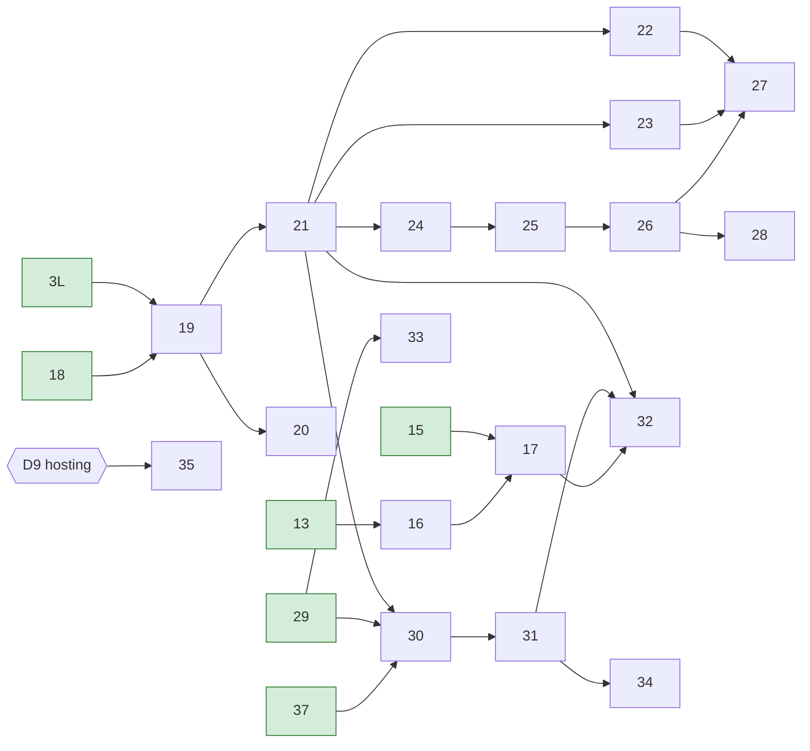

# Delivery plan — v1

The order in which v1 is built, one pull request at a time.
`docs/user-stories.md` says **what** to build. This file says **in what order** and **which PR does what**.
If the two disagree, the stories win. Fix this file in the same PR.

## 1. Where we are

Updated on 2026-10-27, after #40. No step is in progress: there are no open PRs. 20 of 38 steps are done; 18 remain.

On `main`:

- Django skeleton, settings, CI for both sides, run only for the side that changed (#6, #14). CI builds the frontend and checks the API client (step 36, #18).
- Domain models and admin (#5). They already meet US-WR-02, US-WR-10, US-WR-11 and US-WR-14, and parts of the other WR stories.
- Figma export in `design/`.
- **Phase 1 is done**: scaffold (1, #11), shared queries (2, #10), search index and demo data (3, 5, landed by 3L, #16), re-anchoring (4, #9), tags in search entries (37, #38).
- **Phase 2 (editor panel) is done**: typescript upload (6, #25), note content (7, #28), secondary text text (8, #29), material content (9, #30), rich text (10, #31), the tagger (11, #32), the editors group (12, #34). Every WR story is met except US-WR-13 AC2 (step 28).
- The page shell (13, #17), About (14, #19), the works list (15, #21), the typescripts list (18, #35) and the search entry (29, #37). `backend/api/` serves `/api/about/`, `/api/works/`, `/api/typescripts/` and the staff-only `/api/editor/fragments/`.
- Outside the plan: search behaviour tests (#20), `manage.py` loads the repo-root `.env` (#26), Django serves `/media/` from `MEDIA_ROOT` when `AWS_STORAGE_BUCKET_NAME` is unset (#36), the editor panel in Polish with `make messages` (#39), a backend suite on 4 xdist workers (#40).

Missing: the tags list and home page, every entity page (typescript, work, tag, secondary text, note, material), search results and filters, draft preview, autocomplete, the featured fragment, meta tags, production.

What the done work changes for the rest:

- **The editor panel is finished, so all remaining work is public pages and search.** Every remaining step except 34 and 35 adds an endpoint to `backend/api/` and a page, so they all touch the files in 4.4.
- **Only three steps are ready (4.1), down from ten.** Everything else waits on step 19, then step 21. Step 19 is now the bottleneck: start it first.
- **Editor-visible backend strings are translated** (#39, AGENTS.md). A step that adds a model, a field, an admin label or a validation message runs `make messages`. A new `archive` model also needs a data migration that grants its permissions to "Redaktorzy" (#34). No remaining step plans one.
- **Rich text has landed** (#31): every page step renders descriptions through `components/RichText.tsx`.
- **Open questions from merged PRs** (D27–D29) are answered in section 3. Only D9 (hosting) is still open, and it blocks only step 35.

## 2. How we work

1. **Pick a ready step** from section 4: every step in its "Needs" is ticked in section 5. Prefer a step on the critical path (4.3). Step numbers are IDs, not order. A step added later takes a free ID (e.g. 3L).
2. **Claim it before you start.** Run `gh pr list --state open` and `git ls-remote origin <branch>`. If the step's branch or PR exists, someone has it: pick another step. Otherwise push the branch and open a **draft** PR right away, so the next agent sees the claim.
3. **One step = one branch = one PR, based on `main`.** Do not stack PRs. If a step needs an unmerged one, wait for it to merge. A PR merged into another feature branch does not count as done (see 3L). The branch name is in the table. A page story's PR contains its endpoint, its page and their tests (D11). The core owner reviews the core part (CODEOWNERS).
4. **Brief the agent** with `docs/agent-prompt.md`. It picks and claims a step, simplifies and reviews its own code, and ends with a PR ready for review. To name the step yourself, brief it with the step's row and its story. For example: *"Implement step 21 of `docs/plan.md` (US-RA-04). Read AGENTS.md, the story, architecture §… and the design files listed."*
5. **Before you mark the PR ready, rebase on `main`.** Parallel steps touch the same files (4.4). Resolve conflicts by keeping both sides. Never hand-merge `frontend/src/api/`: take `main`'s copy and run `make api-client` again. If a migration number collides, renumber yours.
6. **Definition of done** is the one in `AGENTS.md`. In the same PR, tick the step's box in section 5. Notes a PR leaves for later steps go into those steps' rows in this file, in the same PR, not only into the PR description.
7. **When in doubt, stop and ask.** This applies to an ambiguous story, a conflict with the docs, a new dependency, or a change to `docs/architecture.md`. Do not guess.
8. A human reviews and merges. An agent never merges.

## 3. Decisions

Answered by the project owner on 2026-10-26. Each one lands in the step named in the last column.

| # | Question | Decision | Step |
|---|----------|----------|------|
| D1 | Re-anchoring. Architecture §4.4 moves a fragment when its quote occurs once in the new text. US-WR-09 AC4 says "never silently moved". | **Move and flag.** If the quote occurs exactly once in the new text, move the fragment there and set `needs_review`. Otherwise only set `needs_review`. A moved fragment is never silent, so the story holds. Update architecture §4.4. | 4 |
| D2 | New dependencies. | **Approved.** Backend: `pypdf` (PDF page count). Frontend: the architecture §2 stack, plus `openapi-fetch`, Vitest, Testing Library, MSW, `vitest-axe`, ESLint, `typescript-eslint`, Prettier, `@fontsource/lora`, `@fontsource/cousine`, and the Radix packages shadcn/ui pulls in. Each PR still names the ones it adds. | 1, 6 |
| D3 | `django-prose-editor` has no type stubs. | **One mypy override** (`ignore_missing_imports` for that module) in `pyproject.toml`, with a comment saying why. | 10 |
| D4 | When the main typescript changes, the old one keeps its fragments. Are they public? | **Yes, they stay visible.** A fragment is visible when its owner is published, as in architecture §4.4. The tagger still offers only the main typescript (US-WR-09 AC1). | 2 |
| D5 | R-08 shows author and source for contextual materials, but US-WR-07 gives them no such fields. | **No new fields.** A contextual material shows its title only (R-02: empty parts are not rendered). | 21 |
| D6 | US-WR-01 AC2: how do editors get "the same rights"? | **A "Redaktorzy" group.** A data migration creates it with all `archive` model permissions. The administrator adds editors to it. | 12 |
| D7 | Where does the footer funding note come from? | **Hardcoded** in `frontend/src/copy/pl.ts`. Remove "editable funding note" from US-RA-03 AC1 and US-WR-11 AC1 (`user-stories.md` and `user-stories.pl.md`), remove `SiteSettings.funding_note` with a migration, and update architecture §4.2. | 13 |
| D8 | Who is the core owner? | **@natancamenzind.** Add `.github/CODEOWNERS` for `backend/archive/`, `backend/search/`, `backend/api/` and `**/migrations/`. A human adds the new CI jobs to the required checks on `main`. | 1 |
| D9 | Production hosting (architecture §10). | **Open.** It blocks only the last step. | 35 |
| D10 | Architecture §2 says frontend tests are "`tsc` + ESLint", but AGENTS.md requires Vitest with 90% coverage. | **AGENTS.md wins.** Fix architecture §2. | 1 |
| D11 | AGENTS.md says frontend work uses the API as it is. Who builds a page's endpoint? | **One PR per page story**, with its endpoint, page and tests. The core owner reviews the backend part. AGENTS.md is updated (done in the PR that adds this plan). | 13+ |

Answered in Phase 1 PRs on 2026-10-27:

| # | Question | Decision | Step |
|---|----------|----------|------|
| D12 | Can re-anchoring clear `needs_review` when a quote comes back? (#9) | **No.** Only the editor clears it. Architecture §4.4 says so. | 4 (done) |
| D13 | The schema had no paths, so step 1 made `/api/schema/` document itself. (#11) | **Temporary.** The first page endpoint to merge removes it, together with the placeholder home page and its tests. D21 keeps the placeholder page. | 14 (done) |
| D14 | Frontend dependencies D2 did not name. (#11) | **Approved:** `clsx`, `tailwind-merge`, `@vitest/coverage-v8`, `jsdom`, `@testing-library/jest-dom`, and the Vite/ESLint helpers. TypeScript is pinned to 5.9 until typescript-eslint supports 6. | 1 (done) |
| D15 | A CI action to skip the side that didn't change. (#14) | **Approved:** `dorny/paths-filter@v3`. | done |

Answered by the project owner on 2026-10-27, after the Phase 1 refinement:

| # | Question | Decision | Step |
|---|----------|----------|------|
| D16 | Licence of the real *Czarny potok* excerpt that #13 committed (pages 5–9 of the book, scan and text) to a public MIT repo. | **Placeholder text only.** The real excerpt is removed and the demo uses invented text, like the other typescripts. | 3L |
| D17 | Search needs PostgreSQL 19 (`polish`), but local machines ran 14. | **`SEARCH_TS_CONFIG` comes from the environment**, default `polish`. CI and production keep `polish`. A machine without PG 19 sets `simple` and loses only inflection. README says how to install PG 19. One line in architecture §6. | 3L |
| D18 | Does search find items by the tags they carry? US-RA-14 AC2 promises "tytuły, opisy, transkrypcje i tagi". | **Yes.** The names of a fragment's or item's published tags go into its own entry, at weight B. Saving a tag re-indexes what carries it. Update architecture §6. | 37 |
| D19 | What is "a work's fragment count" (US-RA-01 AC3, US-RA-18, US-RA-08 AC2, US-RA-07 AC2)? | **The main typescript's visible fragments.** On the tag page: the main typescript's fragments that carry the tag. Write it into US-RA-01 AC3 (`user-stories.md` and `user-stories.pl.md`). | 15 |
| D20 | Where do the previews' "Wszystkie fragmenty (n)" links go? | **No new page.** On the typescript page, the link expands the list in place. On the work page, it opens the main typescript page with that list expanded. Write it into R-09 (both story files). | 19 |

Answered by the project owner on 2026-10-27, for step 14:

| # | Question | Decision | Step |
|---|----------|----------|------|
| D21 | D13 removes the placeholder home page with the schema's self-documentation. What is at `/` until step 17? | **Keep the placeholder, without its API call.** It shows only the title and the "w budowie" lead: no schema request, no loading or error copy. Its unused copy and tests go. Step 17 replaces the page. | 14 (done) |

Answered by the project owner on 2026-10-27, for steps 15 and 16:

| # | Question | Decision | Step |
|---|----------|----------|------|
| D22 | `Work` has no author field, but the work card shows "Leopold Buczkowski" (US-RA-01 AC3). | **One constant in `frontend/src/copy/pl.ts`.** The archive covers a single author. No model field, no migration. | 15 (done) |
| D23 | What does the work card show when the fragment count (D19) is 0? | **No count** (R-02). The card footer keeps only the arrow. Written into US-RA-01 AC3 next to D19 (`user-stories.md` and `user-stories.pl.md`). | 15 (done) |
| D24 | The works list needs the section header's counter and description, which step 19 was to add. | **Step 15 builds them**, as optional props of `components/SectionHeader.tsx`. Step 19 adds only what is still missing from R-09. | 15 (done) |
| D25 | A work without a cover. | **The placeholder board** (design/rules.md, Materiały zastępcze). No fallback to an edition's cover. | 15 (done) |
| D26 | US-RA-20 AC2 lists "every published tag", but the cloud shows only tags in use. Does the index list published tags with no occurrence? | **No.** The index and the cloud show the same tags: published, with at least one occurrence (`in_use()`). Write it into US-RA-20 AC2 (`user-stories.md` and `user-stories.pl.md`). | 16 |

Answered by the project owner on 2026-10-27, for questions raised by merged PRs:

| # | Question | Decision | Step |
|---|----------|----------|------|
| D27 | Relation tags (`SecondaryTextWorkLink.tags`, `MaterialWorkLink.tags`, US-RA-05) are not in any search entry. Should searching a relation tag's name find the secondary text or material? (#38) | **No.** Relation tags stay out of search. No CORE follow-up. | 30 |
| D28 | Two editor-panel labels with no glossary term: slug is "Końcówka adresu", site settings are "Treści serwisu". Keep them? (#39) | **Keep them.** | — |
| D29 | Genre is shown as stored ("powieść"); Figma shows "Powieść". The typescripts hero has no count ("Pięć jednostek…" in Figma). Capitalise the genre on display or in the data? Add a live count to the hero? (#35) | **Shown as stored, no count.** Steps 17, 21 and 23 show the genre the same way as steps 15 and 18. | 17, 21, 23 |
| D30 | Storage provider (architecture §10). | **Amazon S3.** The code still depends only on the S3 API. | 35 |
| D31 | Open questions 1–3 and 5 of `user-stories.md` §5. | **The defaults hold**, except question 5: the stories win and Figma is not updated. Question 4 (an example of a tagged relation) stays with the editors. | — |

## 4. Order and dependencies

A step can start when every step in its "Needs" (section 5) is merged into `main`. Nothing else orders the work. The phases group steps by topic, not by time.

### 4.1 Ready now

Snapshot as of 2026-10-27, after #40. Recompute it from section 5 if this is stale.

| Step | Story | Lane | Needs (all merged) |
|------|-------|------|--------------------|
| 19 | US-RA-08: typescript page | Entity pages, **critical path** | 3L, 18 |
| 16 | US-RA-20: tags list | Public pages | 13 |
| 33 | US-RA-17: autocomplete (Should) | Search | 29 |

All three can run at the same time. Start 19 first: 13 of the 18 remaining steps wait on it. 4.4 lists the files they share.

### 4.2 Waves

Each wave holds the steps whose needs are all in earlier waves. A step does not wait for its whole wave: it starts as soon as its own needs merge.

| Wave | Steps | Each step waits for | Parallel |
|------|-------|---------------------|----------|
| done | 1–15, 18, 29, 36, 37, 3L | — | — |
| A | 16, 19, 33 | see 4.1 | 3 |
| B | 17, 20, 21 | 17 ← 15, 16 · 20, 21 ← 19 | 3 |
| C | 22, 23, 24, 30 | 22, 23, 24 ← 21 · 30 ← 21, 29, 37 | 4 |
| D | 25, 31 | 25 ← 24 · 31 ← 30 | 2 |
| E | 26, 32, 34 | 26 ← 25 · 32 ← 17, 21, 31 · 34 ← 31 | 3 |
| F | 27, 28 | 27 ← 22, 23, 26 · 28 ← 26 | 2 |
| blocked | 35 | decision D9 (hosting) | — |

At most four steps run at once (wave C). With enough agents, the 17 unblocked steps take six rounds of merges.

### 4.3 Dependency graph

The longest chain decides when v1 is done. Take steps on it first:

**Critical path: 19 → 21 → 24 → 25 → 26 → 27 / 28** (six rounds). The search chain is one round shorter and also waits on 21: **21 → 30 → 31 → 32 / 34.**

The chain 24 → 25 → 26 is real, not an artefact of the plan: the note and material pages use the secondary text page's layout and its "Powiązane fragmenty" (US-RA-11, US-RA-12), and the material page reuses the note page's content by type (US-RA-12 AC3).

Steps with nothing waiting on them (20, 33, and 16 once 17 is taken) are off the critical path. Fill free slots with them.

The same graph as a list, for reading without a renderer. "X ← Y" means X needs Y. Done steps are left out.

- 16 ← 13 (done)
- 17 ← 15 (done), 16
- 19 ← 3L, 18 (done)
- 20, 21 ← 19
- 22, 23, 24 ← 21
- 25 ← 24
- 26 ← 25
- 27 ← 22, 23, 26
- 28 ← 26
- 30 ← 21, 29 (done), 37 (done)
- 31 ← 30
- 32 ← 17, 21, 31
- 33 ← 29 (done)
- 34 ← 31
- 35 ← D9

### 4.4 Shared files

These steps do not depend on each other, but they edit the same files. Run them in parallel anyway. Whichever merges second rebases (section 2, rule 5).

| Files | Steps | What to watch |
|-------|-------|---------------|
| `backend/api/urls.py`, `views.py`, `serializers.py`, `frontend/src/routes.tsx`, `frontend/src/copy/pl.ts`, `frontend/src/api/` | every page step: 16–33 | Each adds its own entries. Regenerate `frontend/src/api/` after the rebase, never merge it by hand. |
| `components/SectionHeader.tsx`, `PageHeader.tsx` | 16, 19, 17 | 19 adds the preview link to R-09. 16 and 17 use the header as it is. |
| `components/layout/SiteHeader.tsx`, `components/SearchField.tsx`, `lib/search.ts` | 30, 31, 33 | 33 adds suggestions to both fields; 30 and 31 change the search page. 33 can run alongside all of wave A–C. |
| `pages/HomePage.tsx`, `/api/home/` | 17, 32 | 32 waits for 17 anyway. |
| `frontend/src/components/` page parts | 21–26 | 21 builds the fragment card and the materials block, 24 the related-fragments query, 25 the content by type. Later steps import them, never copy them (section 7). |
| `backend/search/` | 30, 31, 33 | 30 adds the endpoint; 31 the filters; 33 its own autocomplete query. |

## 5. Steps

### Phase 1 — Foundations

| ✓ | # | PR | Branch | Needs | Scope |
|---|---|----|--------|-------|-------|
| [x] | 1 | FE: frontend scaffold and serving | `fe/scaffold` | — | `frontend/` with Vite, React, TS strict, React Router, TanStack Query, Tailwind on `design/tokens/tokens.css`, shadcn/ui, fonts, Vitest + Testing Library + MSW + axe, ESLint, Prettier. `copy/pl.ts` with the Polish plural helper. The generated client from `make api-client`. `site_shell`: Django serves `index.html` for every non-API URL, and Vite proxies in dev. Makefile `dev`/`test`/`lint`/`typecheck`/`api-client` cover both sides. CI runs the frontend jobs. One placeholder route proves the chain works. `.github/CODEOWNERS` (D8). Fix architecture §2 (D10). |
| [x] | 2 | CORE: shared queries | `core/shared-queries` | — | Querysets in `archive`, reused by every endpoint and by search: published only (R-06), visible fragments (owner published, D4), published tags only, the year of a work, tag occurrences, the works an item relates to, and the works a tag refers to (US-RA-07 AC5). The preview helper with `PREVIEW_LIMIT` (§4.5), and fragment number and start page. Tests only, no endpoints. |
| [x] | 3 | CORE: search index | `core/search-index` | 2 | The `backend/search/` app: `SearchEntry`, writes and removals from `save()`/`delete()` (§6), `Edition` saves its work, `rebuild_search_index`, and a test that the `polish` config exists. A query service with tabs, filters, facet counts, sorting, snippets and the "no results" tags. No endpoint yet. Meets US-WR-04 AC4. |
| [x] | 4 | US-WR-09 AC4: flag every moved fragment | `us-wr-09-reanchor` | — | `Fragment.reanchor()` sets `needs_review` whenever it moves a fragment (D1). Update architecture §4.4. |
| [x] | 5 | DEV: demo data | `dev/demo-data` | 3 | `manage.py load_demo_data` loads the sample data from `design/rules.md`, including small committed PDF and OCR fixtures. It uses `save()` only, so the search index is filled. Every later PR is verified by hand with it. |
| [x] | 3L | CORE: land search index and demo data | `core/land-search-index` | 4 | Merge `main` into `core/search-index` and open the PR against `main`. Resolve `Fragment.reanchor()`: keep step 4's body (D1, D12) and step 3's index write after it. Then: D16 (replace the real *Czarny potok* excerpt with placeholder text and drop its README note), D17 (`SEARCH_TS_CONFIG` from the environment). #13's review findings: the empty-database guard is tested for all five models, including `Institution` and `SiteSettings`. #10's review nits: `with_occurrences()` and `preview()` docstrings say callers chain `.published()` and pass their own cross-document order. Architecture: drop §10.3 (answered by D2). Ticks 3 and 5. |
| [x] | 36 | CI: frontend build and API client check | `ci/frontend-build` | — | CI runs `npm run build`, because `tsc --noEmit` misses what only fails at build time: the token plugin reading `design/tokens/tokens.css`, asset paths, the `/static/` base. CI also runs `make api-client` and fails if `frontend/src/api/` changed. Both are #11 review findings. |
| [x] | 37 | CORE: tags in search entries | `core/search-tags` | 3L | D18: a fragment's or item's published tag names go into its search entry at weight B. Saving, publishing or unpublishing a tag re-indexes what carries it. Update architecture §6. A test that "dezerter" finds a fragment tagged Dezerter whose quote lacks the word. |

### Phase 2 — Editor panel (done)

| ✓ | # | PR | Branch | Needs | Scope |
|---|---|----|--------|-------|-------|
| [x] | 6 | US-WR-04: typescript text upload | `us-wr-04-typescript-upload` | 3L | Scan and OCR file on the typescript form, with the page-count check and its message (AC2). The upload is built so steps 7–9 can reuse it. Its `Document` is created and replaced from the item's form. The editor never opens a `Document` form or picks one by ID; the Document admin leaves the editors' menu. Try a full-length OCR text: PostgreSQL caps a `tsvector` at 1 MB, and the save must not fail on a whole novel (#16). |
| [x] | 7 | US-WR-05: note content | `us-wr-05-note-content` | 6 | All five content kinds on the note form, with OCR or plain text entered on that form. Reuse `archive.forms.TextUploadForm` and `archive.uploads.load_ocr_upload` from step 6 for OCR kinds; add plain-text upload on the same form pattern. Left for steps 8–9: `PlainTextForm` (OCR or typed text via `text_kind()`) and `MediaContentForm` / `MediaContentAdmin` (content kinds + dropping a text). `Archival.save` deletes an orphan text; `Archival.clean`/`save` refuse to drop one that still has fragments. |
| [x] | 8 | US-WR-06: secondary text text | `us-wr-06-secondary-text` | 6 | OCR or plain text on the secondary text form. Subclass `PlainTextForm` from step 7, override `text_kind()`, exclude `document`, switch the admin to `TextUploadAdmin`, drop `raw_id_fields`. If the work-link inline keeps `min_num`, override `get_formset(..., validate_min=True)` like `MaterialWorkLinkInline` in step 9. |
| [x] | 9 | US-WR-07: contextual material content | `us-wr-07-material-content` | 6 | `ContextualMaterialForm` on `MediaContentAdmin`; work links enforce `min_num` via `validate_min=True`. Step 7 (#28) landed the shared `MediaContentForm` first. |
| [x] | 10 | CORE: rich text (US-WR-03, 08, 12) | `core/rich-text` | 3L | `ProseEditorField` for descriptions, with the mypy override (D3), the About project text and the introductions. Search strips HTML from indexed descriptions via `html_to_text` / `description_text`. About page and `PageHeader` render sanitized HTML (`RichText`). Later page steps: pass description strings through `RichText` when the API field is HTML (section 7). |
| [x] | 11 | US-WR-09: tagger | `us-wr-09-tagger` | 3L, 6 | The tagger admin view (§5) and `/api/editor/fragments/`. Offered only for the main typescript and for notes, secondary texts and materials that have a text. The endpoint writes outside the admin, so after setting a fragment's tags it calls `fragment.update_search_entry()` and `Tag.update_search_entries()` (#12). Consider giving the work-link models their own index writes in `save()`/`delete()` instead (#16). A "Taguj fragmenty" link on the item's form opens the tagger. |
| [x] | 12 | US-WR-01: editors group | `us-wr-01-editors` | — | A data migration for the "Redaktorzy" group, and tests for both ACs. If another archive migration merges first, renumber this one. |

### Phase 3 — Public site: shell and simple pages

| ✓ | # | PR | Branch | Needs | Scope |
|---|---|----|--------|-------|-------|
| [x] | 13 | US-RA-03: header, navigation, footer | `us-ra-03-footer` | 1 | The page shell from R-07 on desktop and mobile, the active navigation item. The funding note is hardcoded in `copy/pl.ts`; in this PR, update the stories, remove `SiteSettings.funding_note` and update architecture §4.2 (D7). The header search field comes in step 29. Open owner item: the real funding text replaces the placeholder in `copy.layout.fundingNote`. |
| [x] | 14 | US-RA-13: About | `us-ra-13-about` | 13 | `/api/about/`, the About page. As the first page endpoint, it creates `backend/api/` and removes the schema's self-documentation (D13, D21). |
| [x] | 15 | US-RA-18: works list | `us-ra-18-works-list` | 13 | `/api/works/`, the work card, the list page. The card's fragment count follows D19; write it into US-RA-01 AC3. The card follows D22, D23 and D25; the section header gets its counter and description (D24). D13 and D21 are done in step 14: the `backend/api/` app exists (views, serializers, urls), and the schema describes the real endpoints only. Add the endpoint there and leave `HomePage` as it is. |
| [x] | 16 | US-RA-20: tags list | `us-ra-20-tags-list` | 13 | `/api/tags/`, the deterministic tag cloud, the alphabetical index. Tags come from `Tag.objects.published()` chained with `with_occurrences()` or `in_use()`; neither filters the tag's own status. The index lists only tags in use, like the cloud (D26). |
| [x] | 17 | US-RA-01: home page | `us-ra-01-home` | 15, 16 | `/api/home/`, the hero with counts and portrait, works, tag cloud. Replaces the placeholder at `/` (D21): `pages/HomePage.tsx`, its test and `copy.home`. Reuse from step 15: `components/WorkCard.tsx`, `WorkCardSerializer` and `Work.objects.published().with_year().with_fragment_count()`. Reuse from step 16: `components/TagCloud.tsx` (the cloud's rows inside a `Card` with `SectionHeader`, given `TagCount[]` in any order), `TagCountSerializer` with `Tag.objects.published().in_use()`, and `copy.tagCloud` for the section header. Genre and the hero's counts follow D29. |
| [x] | 18 | US-RA-19: typescripts list | `us-ra-19-typescripts-list` | 13 | `/api/typescripts/`, grouped by work. Order shelfmarks as numbers, not strings. |

### Phase 4 — Entity pages

| ✓ | # | PR | Branch | Needs | Scope |
|---|---|----|--------|-------|-------|
| [x] | 19 | US-RA-08: typescript page | `us-ra-08-typescript-page` | 3L, 18 | `/api/typescripts/<id>/`, `/api/documents/<id>/`. The shared parts first built here: subpage layout (R-05), section header and preview (R-09), the reader (R-11) with `pdfjs-dist`, the text renderer (§4.4), the mobile toggle, `?fragment=`. The renderer clamps a lost fragment's offsets to the text (#9). The fragment list's "all" link follows D20; write it into R-09. Built in step 14 and extended here, not rebuilt: `components/PageHeader.tsx` (the hero; its `label` takes the entity's type line) and `components/SectionHeader.tsx` (the counter and description exist since step 15, D24; add the rest of R-09: the preview link). Also from step 14: `components/ColumnHeader.tsx` without its count, and the shadcn `components/ui/card.tsx` on the design tokens. From step 18: `components/ListRow.tsx` ("Wiersz listy": two-digit number, title, arrow, link) and `ArrowRightIcon`, for the "Fragmenty z maszynopisu" numbered list. The hero's paper grain (design/rules.md, Ornamenty) is not built yet. Descriptions are HTML: render them with `components/RichText.tsx` (step 10). |
| [x] | 20 | US-RA-09: reading the full typescript | `us-ra-09-full-typescript` | 19 | The reader handles a long typescript: pages render as they scroll into view. Fragments are highlighted wherever they exist (D4). From step 19: `components/Reader.tsx` draws every scan page as soon as the PDF opens (`ScanPage`, one canvas per page at 1.5×) and splits the text with `lib/segments.ts` (O(segments × fragments)); make both lazy here. pdf.js is the legacy build, loaded on demand from `lib/pdf.ts`. jsdom cannot draw a canvas, so page drawing is checked in a browser, not in Vitest. |
| [x] | 21 | US-RA-04: work page | `us-ra-04-work-page` | 19 | `/api/works/<slug>/`. Built here: the fragment card (R-10) with page thumbnail, the note card. From step 19, reuse: `components/EntityLayout.tsx` (R-05), `ContextualMaterials.tsx` (R-08, D5; US-RA-08 AC5 needed it first) fed by `contextual_materials()` and `ContextualMaterialsSerializer` in `backend/api/`, `SideListItem.tsx` for the editions, `TagList.tsx`, `ArrowLink.tsx` and `previewCount()` / `fragmentLabel()` in `copy/pl.ts`, `WorkSummarySerializer`, `TagChipSerializer`. The fragment preview's "all" link goes to `/typescripts/<main id>?fragments=all` (D20, R-09). A fragment links to `/typescripts/<id>?fragment=<id>`. |
| [ ] | 22 | US-RA-05: relation tags | `us-ra-05-relation-tags` | 21 | Work link tags in the work page's tag column. From step 21: US-RA-04 AC4 already includes relation tags (the stories win), so `/api/works/<slug>/` lists them through `Tag.objects.referring_to(work)`, tested in `test_us_ra_04_ac4_every_published_tag_that_refers_to_the_work`. What is left: the US-RA-05 tests (a tag on a secondary text's or a material's work link shows in the column and links to its tag page; a link to a draft item brings none). |
| [ ] | 23 | US-RA-07: tag page | `us-ra-07-tag-page` | 21 | `/api/tags/<slug>/`, the tag page. Reuse from step 19: `EntityLayout`, `ContextualMaterials` with `contextual_materials()`, `SideListItem`, `TagList` (R-05, R-08). Fragments are ordered by the work's year, then by position (`preview()` alone orders by document ID). The per-work count follows D19. From step 21: `components/FragmentCard.tsx` has `FragmentCard` (R-10) and `NoteCard` (US-RA-07 AC3 reuses it); `FragmentCardSerializer` and `NoteCardSerializer` in `backend/api/serializers.py` feed them. `FragmentCardSerializer` works for any source (typescript, note, secondary text, material): it names the source's published works with one query per fragment, so it suits a short list; for every fragment of a tag, prefetch the owners' works instead. `ColumnHeader` takes `level={2}` when no h2 section precedes the column (axe heading-order). `SideListItem` without `to` is not a link. |
| [ ] | 24 | US-RA-10: secondary text page | `us-ra-10-secondary-text-page` | 21 | `/api/secondary-texts/<id>/`. Built here: the "Powiązane fragmenty" query (shared tags), reused in steps 25–26. From step 19: `components/Reader.tsx` reads `/api/documents/<id>/` (OCR or plain text, `?fragment=`) and `EntityLayout`, `ContextualMaterials`, `TagList`. From step 20: the reader draws a scan page only while it is within a screen of the view and splits the text once per document, so it takes a whole text as it is. Tests that render it get a fake `IntersectionObserver` from `src/test/setup.ts`; `scrollIntoViewport()` in `src/test/intersection.ts` brings a scan page into view. From step 21: `ScanPage` (one drawn scan page) is `components/ScanPage.tsx`, and `usePdf(url)` in `lib/pdf.ts` opens a scan once for the reader and the fragment cards' thumbnails. |
| [ ] | 25 | US-RA-11: note page | `us-ra-11-note-page` | 24 | `/api/notes/<id>/`, the content by type: image, PDF, download, embed or link, reader. From step 21: the note card (`NoteCard`, `NoteCardSerializer`) shows the image of an image note and the placeholder board otherwise. |
| [ ] | 26 | US-RA-12: contextual material page | `us-ra-12-material-page` | 25 | `/api/materials/<id>/`. |
| [ ] | 27 | US-RA-06: drill-down from a work | `us-ra-06-drill-down` | 22, 23, 26 | A test that every item on the work page links to an existing page; fix any that don't. From step 21: editions have no page, so they are not links (US-RA-04 AC2); a fragment card links to `/typescripts/<id>?fragment=<id>`, a note card to `/notes/<id>`. |
| [ ] | 28 | US-WR-13: preview a draft | `us-wr-13-draft-preview` | 26 | Entity endpoints return drafts to staff with `is_draft`. The banner "Szkic — niewidoczny publicznie". Anonymous readers get 404. |

### Phase 5 — Search

| ✓ | # | PR | Branch | Needs | Scope |
|---|---|----|--------|-------|-------|
| [x] | 29 | US-RA-14: search entry | `us-ra-14-search-entry` | 3L, 13 | The header field (the icon on mobile), the `/search` page shell, the hint text. The field goes in the slot marked in `components/layout/SiteHeader.tsx`, next to "O archiwum", which stays in the mobile header too (R-07; Figma's mobile header drops it). Icons are inline components in `components/icons.tsx`, copied from `design/assets/icons/`: add `szukaj` there. |
| [ ] | 30 | US-RA-15: search results | `us-ra-15-search-results` | 29, 21, 37 | `/api/search/`, groups, sorting, snippets, the loading state, no results. Opening a result scrolls to the first match (`?q=`, R-11 AC3). From step 37: tag names are in the entry's `vector` but not its `body`, so a result found only by a tag name has a snippet without `<mark>`; show the snippet unmarked. Relation tags are not searched (D27). Left by #12 for this step: how many of a work's fragments match (AC5), and a test that "potoku" finds "potok" (AC7). No pagination in v1: the archive is small, and the stories and design have none. Snippets: keep `ts_headline` off whole document bodies of results the page doesn't show. A query of only stopwords (`w`, `-`) behaves as an empty query, not as "no results" (#16). From step 29: `pages/SearchPage.tsx` has the field (`components/SearchField.tsx`), the scope line and the hint, and a screen-reader `h1`; add the results below them and read `q` from `useSearchParams` there. Header and page fields both go through `searchUrl()` in `lib/search.ts`, which trims the query and drops a blank one. From step 33: both fields' inputs are `components/SearchCombobox.tsx` (role `combobox`, not `searchbox`; tests mock `/api/search/autocomplete/`), and `search/query.py` has `autocomplete()` next to `search()`. `SuggestionSerializer.type` is named `TypeEnum` in the schema: a second `type` choice field with other values makes drf-spectacular rename both, so name the new one differently or add `ENUM_NAME_OVERRIDES`. `renderRoute()` returns its router, for asserting `router.state.location`. |
| [ ] | 31 | US-RA-16: tabs and filters | `us-ra-16-search-filters` | 30 | Tabs, filters, facet counts, the mobile filter panel, state kept in the URL, the empty query. From step 29: `searchUrl()` in `lib/search.ts` writes only `q`, so a new search from either field drops the tab and filters. Decide whether the page's field keeps them, and test it. |

### Phase 6 — Should

| ✓ | # | PR | Branch | Needs | Scope |
|---|---|----|--------|-------|-------|
| [ ] | 32 | US-RA-02: featured fragment | `us-ra-02-featured-fragment` | 17, 21, 31 | A random featured fragment on the home page, linking to the filtered search. From step 17: `/api/home/` (`home` in `backend/api/views.py`, `HomePageSerializer`) has no featured fragment yet; add it there, as architecture §7 lists. `pages/HomePage.tsx` renders the hero, then the works card, then the cloud card; the fragment card goes between them (US-RA-01 AC1). Its counter's total is `statistics.fragments`, all visible fragments. From step 21: render it with `components/FragmentCard.tsx` and serialize it with `FragmentCardSerializer`. |
| [x] | 33 | US-RA-17: autocomplete | `us-ra-17-autocomplete` | 29 | `/api/search/autocomplete/` and the suggestions under the field. From step 29: two fields take suggestions, the desktop header form in `components/layout/SiteHeader.tsx` and `components/SearchField.tsx` on the search page. On mobile the header has only an icon link to `/search`. |

### Phase 7 — Release

| ✓ | # | PR | Branch | Needs | Scope |
|---|---|----|--------|-------|-------|
| [ ] | 34 | CORE: per-URL meta tags | `core/meta-tags` | 31 | `site_shell` sets `<title>` and the meta description for every route (user stories §4: SEO). An unknown URL or a draft for an anonymous reader returns status 404, not a 200 with the React 404 page. Paths starting with a dot (`/.env`) return 404 (#11 review). |
| [ ] | 35 | Production setup | `ops/production` | D9 (open) | Production settings and deployment notes for the chosen host. The deploy runs `npm run build` (`make build-frontend`, step 36) before `collectstatic` and before Django starts (#11). Uploads: set `AWS_STORAGE_BUCKET_NAME`. Without it Django serves `/media/` from `MEDIA_ROOT` (#36), which is for local development only. The committed `.mo` catalogue is used as is (#39), so the server needs no gettext. |

## 6. Story coverage

| Story | Step | Story | Step |
|-------|------|-------|------|
| US-RA-01 | 17 | US-WR-01 | done (12) |
| US-RA-02 (Should) | 32 | US-WR-02 | done (PR #5) |
| US-RA-03 | done (13; story changed, D7) | US-WR-03 | done (10) |
| US-RA-04 | done (21) | US-WR-04 | done (6) |
| US-RA-05 | 22 | US-WR-05 | done (7) |
| US-RA-06 | 27 | US-WR-06 | done (8) |
| US-RA-07 | 23 | US-WR-07 | done (9) |
| US-RA-08 | 19 | US-WR-08 | done (10) |
| US-RA-09 | 20 | US-WR-09 | done (4, 11) |
| US-RA-10 | 24 | US-WR-10 | done (PR #5) |
| US-RA-11 | 25 | US-WR-11 | done (PR #5); funding note removed in 13 |
| US-RA-12 | 26 | US-WR-12 | done (10) |
| US-RA-13 | done (14) | US-WR-13 | AC1 done; 28 |
| US-RA-14 | done (29) | US-WR-14 | done (PR #5) |
| US-RA-15 | 30 | | |
| US-RA-16 | 31 | | |
| US-RA-17 (Should) | done (33) | | |
| US-RA-18 | done (15) | | |
| US-RA-19 | done (18) | | |
| US-RA-20 | 16 | | |

Rules R-01 to R-12 have no step of their own. Each page step meets them for its page.

## 7. Reminders for every step

- **Stories beat Figma** (open question 5, D31). Figma is not updated. Figma has no reader, no note page and no contextual material page, and its fragment card shows a scan crop. Build these from the stories, using the existing Figma components.
- **Mobile is part of each page step**, not a separate PR. `design/rules.md` → Siatka gives the order.
- **Shared UI parts** (layout, section header, fragment card, reader, contextual materials block) are built in the step named above and reused after that, never rebuilt.
- **shadcn overlays need a token.** The theme removes Tailwind's default colours, so the generated `bg-black/50` of Dialog and Sheet compiles to nothing. Map it to a token in the first step that adds one (step 31's filter panel at the latest).
- **Migrations from parallel steps** can collide on a number. Whichever merges second renumbers. No remaining step plans a migration; step 28 might add one.
- **Editor-visible strings are translated** (#39). Any new `verbose_name`, `help_text`, choice label, validation message or admin template string is English with `gettext_lazy` / ``, then `make messages` and the Polish entry in `django.po` (AGENTS.md). A new `archive` model also needs a data migration that adds its permissions to "Redaktorzy" (#34).
- **Each component test runs the axe check** (R-12). Polish copy lives in `copy/pl.ts` and counts use the plural helper.
- **Draft tags are never shown**: not as chips, not in the cloud, not in counts. Step 2's querysets handle this.
- **Links to pages built later are fine.** Step 27 checks them all.
- **Descriptions are HTML** (step 10 landed). Render them with `components/RichText.tsx`, as the sanitized HTML the API returns.
- A page step builds only its own endpoint. If it needs anything else from the backend, say so in the PR (AGENTS.md). A change to `docs/architecture.md` needs asking first.

## 8. Follow-ups outside the steps

Review findings from merged PRs that no step owns. None blocks v1. Take one only when the core owner asks for it, as its own `CORE:` or `TEST:` PR.

| From | Finding |
|------|---------|
| #28 | Saving a plain-text item re-indexes it three times (`Document.save` → owner, `Publishable.save`, `save_related`). Needs a core change to `Document.save`. |
| #38 | `Tag.save()` re-indexes every carrier on every save, including description-only edits of a draft tag. Fine at the archive's size. |
| #38 | The demo index test leaves `title` and `has_text` out of its comparison. |
| #37 | `FOCUS_CLASSES` is defined in `SiteHeader.tsx` and `SearchField.tsx`, and other components inline the same string. The search field's widths use Tailwind's container scale, not a design token. |
| #37 | Nobody has looked at the header and the search page in a browser at desktop and 360 px. |
| #44 | `autocomplete()` matches `lower(title COLLATE "und-x-icu")`, because a `C`-collated database folds only ASCII ("ś" missed "Śmierć"). It does not use the `title` trigram index that architecture §6 reserves for autocomplete: an expression index on that lowercased title would need a migration. Suggestions sort by title in the database collation, like search results. |
| #39 | The tagger API's error messages (`backend/api/editor_fragments.py`) are in English. The tagger UI does not show them. |
