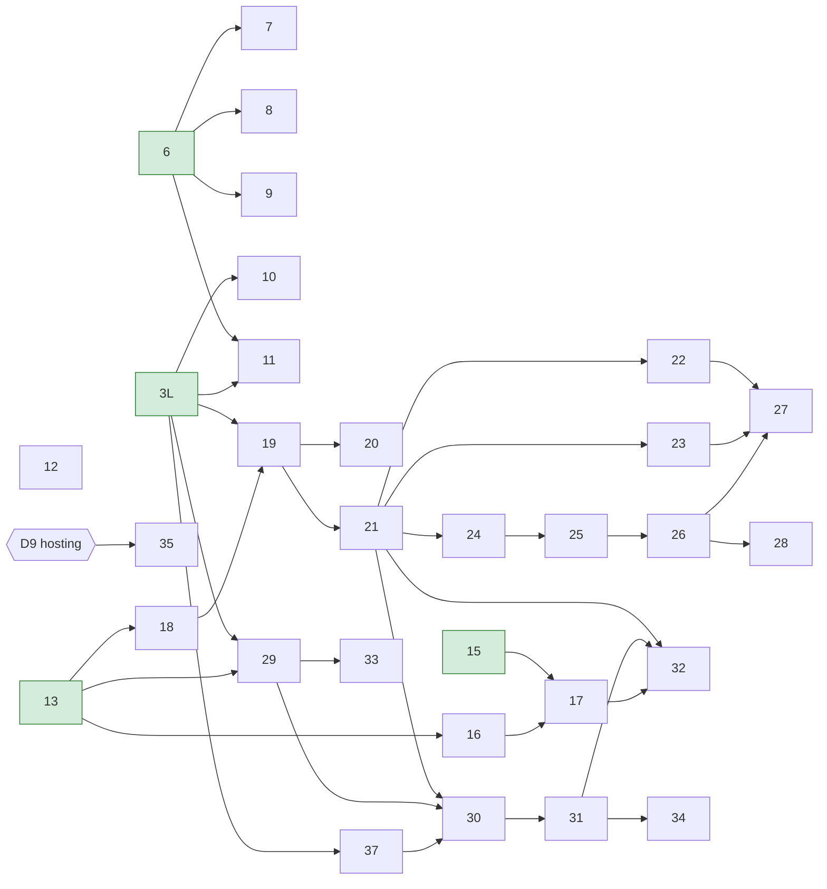

# Delivery plan — v1

The order in which v1 is built, one pull request at a time.
`docs/user-stories.md` says **what** to build. This file says **in what order** and **which PR does what**.
If the two disagree, the stories win. Fix this file in the same PR.

## 1. Where we are

Updated on 2026-10-27, after #26. No step is in progress: there are no open PRs.

On `main`:

- Django skeleton, settings, CI for both sides, run only for the side that changed (#6, #14). CI builds the frontend and checks the API client (step 36, #18).
- Domain models and admin (#5). They already meet US-WR-02, US-WR-10, US-WR-11 and US-WR-14, and parts of the other WR stories.
- Figma export in `design/`.
- Phase 1 is done except step 37: scaffold (1, #11), shared queries (2, #10), search index and demo data (3, 5, landed by 3L, #16), re-anchoring (4, #9).
- Typescript text upload (6, #25). #23 was merged and reverted (#24); #25 is the version on `main`.
- The page shell (13, #17), About (14, #19) and the works list (15, #21). `backend/api/` serves `/api/about/` and `/api/works/`.
- Outside the plan: search behaviour tests (#20), `manage.py` loads the repo-root `.env` (#26).

Missing: the other public pages, search, rich text, the tagger, the editors group, content upload for notes, secondary texts and materials, meta tags, production.

## 2. How we work

1. **Pick a ready step** from section 4: every step in its "Needs" is ticked in section 5. Prefer a step on the critical path (4.3). Step numbers are IDs, not order. A step added later takes a free ID (e.g. 3L).
2. **Claim it before you start.** Run `gh pr list --state open` and `git ls-remote origin <branch>`. If the step's branch or PR exists, someone has it: pick another step. Otherwise push the branch and open a **draft** PR right away, so the next agent sees the claim.
3. **One step = one branch = one PR, based on `main`.** Do not stack PRs. If a step needs an unmerged one, wait for it to merge. A PR merged into another feature branch does not count as done (see 3L). The branch name is in the table. A page story's PR contains its endpoint, its page and their tests (D11). The core owner reviews the core part (CODEOWNERS).
4. **Brief the agent** with `docs/agent-prompt.md`. It picks and claims a step, simplifies and reviews its own code, and ends with a PR ready for review. To name the step yourself, brief it with the step's row and its story. For example: *"Implement step 21 of `docs/plan.md` (US-RA-04). Read AGENTS.md, the story, architecture §… and the design files listed."*
5. **Before you mark the PR ready, rebase on `main`.** Parallel steps touch the same files (4.4). Resolve conflicts by keeping both sides. Never hand-merge `frontend/src/api/`: take `main`'s copy and run `make api-client` again. If a migration number collides, renumber yours.
6. **Definition of done** is the one in `AGENTS.md`. In the same PR, tick the step's box in section 5. Notes a PR leaves for later steps go into those steps' rows in this file, in the same PR, not only into the PR description.
7. **When in doubt, stop and ask.** This applies to an ambiguous story, a conflict with the docs, a new dependency, or a change to `docs/architecture.md`. Do not guess.
8. A human reviews and merges. An agent never merges.

## 3. Decisions

Answered by the project owner on 2026-10-26. Each one lands in the step named in the last column.

| # | Question | Decision | Step |
|---|----------|----------|------|
| D1 | Re-anchoring. Architecture §4.4 moves a fragment when its quote occurs once in the new text. US-WR-09 AC4 says "never silently moved". | **Move and flag.** If the quote occurs exactly once in the new text, move the fragment there and set `needs_review`. Otherwise only set `needs_review`. A moved fragment is never silent, so the story holds. Update architecture §4.4. | 4 |
| D2 | New dependencies. | **Approved.** Backend: `pypdf` (PDF page count). Frontend: the architecture §2 stack, plus `openapi-fetch`, Vitest, Testing Library, MSW, `vitest-axe`, ESLint, `typescript-eslint`, Prettier, `@fontsource/lora`, `@fontsource/cousine`, and the Radix packages shadcn/ui pulls in. Each PR still names the ones it adds. | 1, 6 |
| D3 | `django-prose-editor` has no type stubs. | **One mypy override** (`ignore_missing_imports` for that module) in `pyproject.toml`, with a comment saying why. | 10 |
| D4 | When the main typescript changes, the old one keeps its fragments. Are they public? | **Yes, they stay visible.** A fragment is visible when its owner is published, as in architecture §4.4. The tagger still offers only the main typescript (US-WR-09 AC1). | 2 |
| D5 | R-08 shows author and source for contextual materials, but US-WR-07 gives them no such fields. | **No new fields.** A contextual material shows its title only (R-02: empty parts are not rendered). | 21 |
| D6 | US-WR-01 AC2: how do editors get "the same rights"? | **A "Redaktorzy" group.** A data migration creates it with all `archive` model permissions. The administrator adds editors to it. | 12 |
| D7 | Where does the footer funding note come from? | **Hardcoded** in `frontend/src/copy/pl.ts`. Remove "editable funding note" from US-RA-03 AC1 and US-WR-11 AC1 (`user-stories.md` and `user-stories.pl.md`), remove `SiteSettings.funding_note` with a migration, and update architecture §4.2. | 13 |
| D8 | Who is the core owner? | **@natancamenzind.** Add `.github/CODEOWNERS` for `backend/archive/`, `backend/search/`, `backend/api/` and `**/migrations/`. A human adds the new CI jobs to the required checks on `main`. | 1 |
| D9 | Production hosting (architecture §10). | **Open.** It blocks only the last step. | 35 |
| D10 | Architecture §2 says frontend tests are "`tsc` + ESLint", but AGENTS.md requires Vitest with 90% coverage. | **AGENTS.md wins.** Fix architecture §2. | 1 |
| D11 | AGENTS.md says frontend work uses the API as it is. Who builds a page's endpoint? | **One PR per page story**, with its endpoint, page and tests. The core owner reviews the backend part. AGENTS.md is updated (done in the PR that adds this plan). | 13+ |

Answered in Phase 1 PRs on 2026-10-27:

| # | Question | Decision | Step |
|---|----------|----------|------|
| D12 | Can re-anchoring clear `needs_review` when a quote comes back? (#9) | **No.** Only the editor clears it. Architecture §4.4 says so. | 4 (done) |
| D13 | The schema had no paths, so step 1 made `/api/schema/` document itself. (#11) | **Temporary.** The first page endpoint to merge removes it, together with the placeholder home page and its tests. D21 keeps the placeholder page. | 14 (done) |
| D14 | Frontend dependencies D2 did not name. (#11) | **Approved:** `clsx`, `tailwind-merge`, `@vitest/coverage-v8`, `jsdom`, `@testing-library/jest-dom`, and the Vite/ESLint helpers. TypeScript is pinned to 5.9 until typescript-eslint supports 6. | 1 (done) |
| D15 | A CI action to skip the side that didn't change. (#14) | **Approved:** `dorny/paths-filter@v3`. | done |

Answered by the project owner on 2026-10-27, after the Phase 1 refinement:

| # | Question | Decision | Step |
|---|----------|----------|------|
| D16 | Licence of the real *Czarny potok* excerpt that #13 committed (pages 5–9 of the book, scan and text) to a public MIT repo. | **Placeholder text only.** The real excerpt is removed and the demo uses invented text, like the other typescripts. | 3L |
| D17 | Search needs PostgreSQL 19 (`polish`), but local machines ran 14. | **`SEARCH_TS_CONFIG` comes from the environment**, default `polish`. CI and production keep `polish`. A machine without PG 19 sets `simple` and loses only inflection. README says how to install PG 19. One line in architecture §6. | 3L |
| D18 | Does search find items by the tags they carry? US-RA-14 AC2 promises "tytuły, opisy, transkrypcje i tagi". | **Yes.** The names of a fragment's or item's published tags go into its own entry, at weight B. Saving a tag re-indexes what carries it. Update architecture §6. | 37 |
| D19 | What is "a work's fragment count" (US-RA-01 AC3, US-RA-18, US-RA-08 AC2, US-RA-07 AC2)? | **The main typescript's visible fragments.** On the tag page: the main typescript's fragments that carry the tag. Write it into US-RA-01 AC3 (`user-stories.md` and `user-stories.pl.md`). | 15 |
| D20 | Where do the previews' "Wszystkie fragmenty (n)" links go? | **No new page.** On the typescript page, the link expands the list in place. On the work page, it opens the main typescript page with that list expanded. Write it into R-09 (both story files). | 19 |

Answered by the project owner on 2026-10-27, for step 14:

| # | Question | Decision | Step |
|---|----------|----------|------|
| D21 | D13 removes the placeholder home page with the schema's self-documentation. What is at `/` until step 17? | **Keep the placeholder, without its API call.** It shows only the title and the "w budowie" lead: no schema request, no loading or error copy. Its unused copy and tests go. Step 17 replaces the page. | 14 (done) |

Answered by the project owner on 2026-10-27, for steps 15 and 16:

| # | Question | Decision | Step |
|---|----------|----------|------|
| D22 | `Work` has no author field, but the work card shows "Leopold Buczkowski" (US-RA-01 AC3). | **One constant in `frontend/src/copy/pl.ts`.** The archive covers a single author. No model field, no migration. | 15 (done) |
| D23 | What does the work card show when the fragment count (D19) is 0? | **No count** (R-02). The card footer keeps only the arrow. Written into US-RA-01 AC3 next to D19 (`user-stories.md` and `user-stories.pl.md`). | 15 (done) |
| D24 | The works list needs the section header's counter and description, which step 19 was to add. | **Step 15 builds them**, as optional props of `components/SectionHeader.tsx`. Step 19 adds only what is still missing from R-09. | 15 (done) |
| D25 | A work without a cover. | **The placeholder board** (design/rules.md, Materiały zastępcze). No fallback to an edition's cover. | 15 (done) |
| D26 | US-RA-20 AC2 lists "every published tag", but the cloud shows only tags in use. Does the index list published tags with no occurrence? | **No.** The index and the cloud show the same tags: published, with at least one occurrence (`in_use()`). Write it into US-RA-20 AC2 (`user-stories.md` and `user-stories.pl.md`). | 16 |

## 4. Order and dependencies

A step can start when every step in its "Needs" (section 5) is merged into `main`. Nothing else orders the work. The phases group steps by topic, not by time: Phase 2 runs alongside Phases 3–5.

### 4.1 Ready now

Snapshot as of 2026-10-27. Recompute it from section 5 if this is stale.

| Step | Story | Lane | Needs (all merged) |
|------|-------|------|--------------------|
| 18 | US-RA-19: typescripts list | Public pages, **critical path** | 13 |
| 29 | US-RA-14: search entry | Search, **critical path** | 3L, 13 |
| 37 | CORE: tags in search entries | Search, **critical path** | 3L |
| 16 | US-RA-20: tags list | Public pages | 13 |
| 7 | US-WR-05: note content | Editor panel | 6 |
| 8 | US-WR-06: secondary text text | Editor panel | 6 |
| 9 | US-WR-07: contextual material content | Editor panel | 6 |
| 10 | CORE: rich text | Editor panel | 3L |
| 11 | US-WR-09: tagger | Editor panel | 3L, 6 |
| 12 | US-WR-01: editors group | Editor panel | — |

All ten can run at the same time. 4.4 lists the files they share.

### 4.2 Waves

Each wave holds the steps whose needs are all in earlier waves. A step does not wait for its whole wave: it starts as soon as its own needs merge.

| Wave | Steps | Each step waits for |
|------|-------|---------------------|
| done | 1, 2, 3, 3L, 4, 5, 6, 13, 14, 15, 36 | — |
| A | 7, 8, 9, 10, 11, 12, 16, 18, 29, 37 | see 4.1 |
| B | 17, 19, 33 | 17 ← 15, 16 · 19 ← 3L, 18 · 33 ← 29 |
| C | 20, 21 | 20 ← 19 · 21 ← 19 |
| D | 22, 23, 24, 30 | 22, 23, 24 ← 21 · 30 ← 21, 29, 37 |
| E | 25, 31 | 25 ← 24 · 31 ← 30 |
| F | 26, 32, 34 | 26 ← 25 · 32 ← 17, 21, 31 · 34 ← 31 |
| G | 27, 28 | 27 ← 22, 23, 26 · 28 ← 26 |
| blocked | 35 | decision D9 (hosting) |

### 4.3 Dependency graph

The longest chain decides when v1 is done. Take steps on it first:

**Critical path: 18 → 19 → 21 → 24 → 25 → 26 → 27 / 28.** The search chain is one wave shorter and also waits on 21: **21 + 29 + 37 → 30 → 31 → 32 / 34.**

Steps with nothing waiting on them (7, 8, 9, 10, 11, 12, 20, 33) are off the critical path. Fill free slots with them.

The same graph as a list, for reading without a renderer. "X ← Y" means X needs Y.

- 7, 8, 9 ← 6
- 10, 37 ← 3L
- 11 ← 3L, 6
- 12 ← nothing
- 16, 18 ← 13
- 17 ← 15, 16
- 19 ← 3L, 18
- 20, 21 ← 19
- 22, 23, 24 ← 21
- 25 ← 24
- 26 ← 25
- 27 ← 22, 23, 26
- 28 ← 26
- 29 ← 3L, 13
- 30 ← 21, 29, 37
- 31 ← 30
- 32 ← 17, 21, 31
- 33 ← 29
- 34 ← 31
- 35 ← D9

### 4.4 Shared files

These steps do not depend on each other, but they edit the same files. Run them in parallel anyway. Whichever merges second rebases (section 2, rule 5).

| Files | Steps | What to watch |
|-------|-------|---------------|
| `backend/archive/admin.py`, `backend/archive/forms.py` | 7, 8, 9, 10, 11 | 7–9 each add a form next to step 6's `TypescriptForm`. 11 adds the "Taguj fragmenty" link to item forms, 10 swaps description widgets. Keep every side. |
| `backend/archive/migrations/` | 10, 12, 37 (if it adds one) | Numbers collide. The second to merge renumbers and fixes its `dependencies`. |
| `Tag.update_search_entries()`, `backend/search/` | 11, 37 | 37 changes what a tag writes into the index; 11 calls it after tagging. Whichever merges second re-runs the other's tests. |
| `backend/api/urls.py`, `views.py`, `serializers.py`, `frontend/src/routes.tsx`, `frontend/src/copy/pl.ts`, `frontend/src/api/` | every page step: 16–34 | Each adds its own entries. Regenerate `frontend/src/api/` after the rebase, never merge it by hand. |
| `components/layout/SiteHeader.tsx` | 29, 33 | 33 waits for 29 anyway. |
| Description rendering | 10 and every page step | A page merged before 10 shows plain text, and step 10 switches it to HTML. A page merged after 10 renders the sanitized HTML from the start (section 7). |
| `components/SectionHeader.tsx`, `PageHeader.tsx` | 16, 18, 19 | 19 adds the preview link to R-09. 16 and 18 use the header as it is. |

## 5. Steps

### Phase 1 — Foundations

| ✓ | # | PR | Branch | Needs | Scope |
|---|---|----|--------|-------|-------|
| [x] | 1 | FE: frontend scaffold and serving | `fe/scaffold` | — | `frontend/` with Vite, React, TS strict, React Router, TanStack Query, Tailwind on `design/tokens/tokens.css`, shadcn/ui, fonts, Vitest + Testing Library + MSW + axe, ESLint, Prettier. `copy/pl.ts` with the Polish plural helper. The generated client from `make api-client`. `site_shell`: Django serves `index.html` for every non-API URL, and Vite proxies in dev. Makefile `dev`/`test`/`lint`/`typecheck`/`api-client` cover both sides. CI runs the frontend jobs. One placeholder route proves the chain works. `.github/CODEOWNERS` (D8). Fix architecture §2 (D10). |
| [x] | 2 | CORE: shared queries | `core/shared-queries` | — | Querysets in `archive`, reused by every endpoint and by search: published only (R-06), visible fragments (owner published, D4), published tags only, the year of a work, tag occurrences, the works an item relates to, and the works a tag refers to (US-RA-07 AC5). The preview helper with `PREVIEW_LIMIT` (§4.5), and fragment number and start page. Tests only, no endpoints. |
| [x] | 3 | CORE: search index | `core/search-index` | 2 | The `backend/search/` app: `SearchEntry`, writes and removals from `save()`/`delete()` (§6), `Edition` saves its work, `rebuild_search_index`, and a test that the `polish` config exists. A query service with tabs, filters, facet counts, sorting, snippets and the "no results" tags. No endpoint yet. Meets US-WR-04 AC4. |
| [x] | 4 | US-WR-09 AC4: flag every moved fragment | `us-wr-09-reanchor` | — | `Fragment.reanchor()` sets `needs_review` whenever it moves a fragment (D1). Update architecture §4.4. |
| [x] | 5 | DEV: demo data | `dev/demo-data` | 3 | `manage.py load_demo_data` loads the sample data from `design/rules.md`, including small committed PDF and OCR fixtures. It uses `save()` only, so the search index is filled. Every later PR is verified by hand with it. |
| [x] | 3L | CORE: land search index and demo data | `core/land-search-index` | 4 | Merge `main` into `core/search-index` and open the PR against `main`. Resolve `Fragment.reanchor()`: keep step 4's body (D1, D12) and step 3's index write after it. Then: D16 (replace the real *Czarny potok* excerpt with placeholder text and drop its README note), D17 (`SEARCH_TS_CONFIG` from the environment). #13's review findings: the empty-database guard is tested for all five models, including `Institution` and `SiteSettings`. #10's review nits: `with_occurrences()` and `preview()` docstrings say callers chain `.published()` and pass their own cross-document order. Architecture: drop §10.3 (answered by D2). Ticks 3 and 5. |
| [x] | 36 | CI: frontend build and API client check | `ci/frontend-build` | — | CI runs `npm run build`, because `tsc --noEmit` misses what only fails at build time: the token plugin reading `design/tokens/tokens.css`, asset paths, the `/static/` base. CI also runs `make api-client` and fails if `frontend/src/api/` changed. Both are #11 review findings. |
| [ ] | 37 | CORE: tags in search entries | `core/search-tags` | 3L | D18: a fragment's or item's published tag names go into its search entry at weight B. Saving, publishing or unpublishing a tag re-indexes what carries it. Update architecture §6. A test that "dezerter" finds a fragment tagged Dezerter whose quote lacks the word. |

### Phase 2 — Editor panel (runs alongside Phases 3–5)

| ✓ | # | PR | Branch | Needs | Scope |
|---|---|----|--------|-------|-------|
| [x] | 6 | US-WR-04: typescript text upload | `us-wr-04-typescript-upload` | 3L | Scan and OCR file on the typescript form, with the page-count check and its message (AC2). The upload is built so steps 7–9 can reuse it. Its `Document` is created and replaced from the item's form. The editor never opens a `Document` form or picks one by ID; the Document admin leaves the editors' menu. Try a full-length OCR text: PostgreSQL caps a `tsvector` at 1 MB, and the save must not fail on a whole novel (#16). |
| [x] | 7 | US-WR-05: note content | `us-wr-05-note-content` | 6 | All five content kinds on the note form, with OCR or plain text entered on that form. Reuse `archive.forms.TextUploadForm` and `archive.uploads.load_ocr_upload` from step 6 for OCR kinds; add plain-text upload on the same form pattern. Left for steps 8–9: `PlainTextForm` (OCR or typed text via `text_kind()`) and `MediaContentForm` / `MediaContentAdmin` (content kinds + dropping a text). `Archival.save` deletes an orphan text; `Archival.clean`/`save` refuse to drop one that still has fragments. |
| [x] | 8 | US-WR-06: secondary text text | `us-wr-06-secondary-text` | 6 | OCR or plain text on the secondary text form. Subclass `PlainTextForm` from step 7, override `text_kind()`, exclude `document`, switch the admin to `TextUploadAdmin`, drop `raw_id_fields`. |
| [ ] | 9 | US-WR-07: contextual material content | `us-wr-07-material-content` | 6 | As in step 7, for contextual materials: a one-line `MediaContentForm` subclass, `MediaContentAdmin` already the base, drop `raw_id_fields`. |
| [ ] | 10 | CORE: rich text (US-WR-03, 08, 12) | `core/rich-text` | 3L | `ProseEditorField` for descriptions, with the mypy override (D3), the About project text and the introductions. Search strips HTML from `body`. Left by step 14: `/api/about/` returns `intro` and `project` as plain text, and `pages/AboutPage.tsx` splits `project` into paragraphs on blank lines. Once they are rich text, the page renders the sanitized HTML the API returns instead. |
| [ ] | 11 | US-WR-09: tagger | `us-wr-09-tagger` | 3L, 6 | The tagger admin view (§5) and `/api/editor/fragments/`. Offered only for the main typescript and for notes, secondary texts and materials that have a text. The endpoint writes outside the admin, so after setting a fragment's tags it calls `fragment.update_search_entry()` and `Tag.update_search_entries()` (#12). Consider giving the work-link models their own index writes in `save()`/`delete()` instead (#16). A "Taguj fragmenty" link on the item's form opens the tagger. |
| [ ] | 12 | US-WR-01: editors group | `us-wr-01-editors` | — | A data migration for the "Redaktorzy" group, and tests for both ACs. If another archive migration merges first, renumber this one. |

### Phase 3 — Public site: shell and simple pages

| ✓ | # | PR | Branch | Needs | Scope |
|---|---|----|--------|-------|-------|
| [x] | 13 | US-RA-03: header, navigation, footer | `us-ra-03-footer` | 1 | The page shell from R-07 on desktop and mobile, the active navigation item. The funding note is hardcoded in `copy/pl.ts`; in this PR, update the stories, remove `SiteSettings.funding_note` and update architecture §4.2 (D7). The header search field comes in step 29. Open owner item: the real funding text replaces the placeholder in `copy.layout.fundingNote`. |
| [x] | 14 | US-RA-13: About | `us-ra-13-about` | 13 | `/api/about/`, the About page. As the first page endpoint, it creates `backend/api/` and removes the schema's self-documentation (D13, D21). |
| [x] | 15 | US-RA-18: works list | `us-ra-18-works-list` | 13 | `/api/works/`, the work card, the list page. The card's fragment count follows D19; write it into US-RA-01 AC3. The card follows D22, D23 and D25; the section header gets its counter and description (D24). D13 and D21 are done in step 14: the `backend/api/` app exists (views, serializers, urls), and the schema describes the real endpoints only. Add the endpoint there and leave `HomePage` as it is. |
| [ ] | 16 | US-RA-20: tags list | `us-ra-20-tags-list` | 13 | `/api/tags/`, the deterministic tag cloud, the alphabetical index. Tags come from `Tag.objects.published()` chained with `with_occurrences()` or `in_use()`; neither filters the tag's own status. The index lists only tags in use, like the cloud (D26). |
| [ ] | 17 | US-RA-01: home page | `us-ra-01-home` | 15, 16 | `/api/home/`, the hero with counts and portrait, works, tag cloud. Replaces the placeholder at `/` (D21): `pages/HomePage.tsx`, its test and `copy.home`. Reuse from step 15: `components/WorkCard.tsx`, `WorkCardSerializer` and `Work.objects.published().with_year().with_fragment_count()`. |
| [ ] | 18 | US-RA-19: typescripts list | `us-ra-19-typescripts-list` | 13 | `/api/typescripts/`, grouped by work. Order shelfmarks as numbers, not strings. |

### Phase 4 — Entity pages

| ✓ | # | PR | Branch | Needs | Scope |
|---|---|----|--------|-------|-------|
| [ ] | 19 | US-RA-08: typescript page | `us-ra-08-typescript-page` | 3L, 18 | `/api/typescripts/<id>/`, `/api/documents/<id>/`. The shared parts first built here: subpage layout (R-05), section header and preview (R-09), the reader (R-11) with `pdfjs-dist`, the text renderer (§4.4), the mobile toggle, `?fragment=`. The renderer clamps a lost fragment's offsets to the text (#9). The fragment list's "all" link follows D20; write it into R-09. Built in step 14 and extended here, not rebuilt: `components/PageHeader.tsx` (the hero; its `label` takes the entity's type line) and `components/SectionHeader.tsx` (the counter and description exist since step 15, D24; add the rest of R-09: the preview link). Also from step 14: `components/ColumnHeader.tsx` without its count, and the shadcn `components/ui/card.tsx` on the design tokens. The hero's paper grain (design/rules.md, Ornamenty) is not built yet. |
| [ ] | 20 | US-RA-09: reading the full typescript | `us-ra-09-full-typescript` | 19 | The reader handles a long typescript: pages render as they scroll into view. Fragments are highlighted wherever they exist (D4). |
| [ ] | 21 | US-RA-04: work page | `us-ra-04-work-page` | 19 | `/api/works/<slug>/`. Built here: the fragment card (R-10) with page thumbnail, the note card, the contextual materials block (R-08), where a contextual material shows its title only (D5). |
| [ ] | 22 | US-RA-05: relation tags | `us-ra-05-relation-tags` | 21 | Work link tags in the work page's tag column. |
| [ ] | 23 | US-RA-07: tag page | `us-ra-07-tag-page` | 21 | `/api/tags/<slug>/`, the tag page. Fragments are ordered by the work's year, then by position (`preview()` alone orders by document ID). The per-work count follows D19. |
| [ ] | 24 | US-RA-10: secondary text page | `us-ra-10-secondary-text-page` | 21 | `/api/secondary-texts/<id>/`. Built here: the "Powiązane fragmenty" query (shared tags), reused in steps 25–26. |
| [ ] | 25 | US-RA-11: note page | `us-ra-11-note-page` | 24 | `/api/notes/<id>/`, the content by type: image, PDF, download, embed or link, reader. |
| [ ] | 26 | US-RA-12: contextual material page | `us-ra-12-material-page` | 25 | `/api/materials/<id>/`. |
| [ ] | 27 | US-RA-06: drill-down from a work | `us-ra-06-drill-down` | 22, 23, 26 | A test that every item on the work page links to an existing page; fix any that don't. |
| [ ] | 28 | US-WR-13: preview a draft | `us-wr-13-draft-preview` | 26 | Entity endpoints return drafts to staff with `is_draft`. The banner "Szkic — niewidoczny publicznie". Anonymous readers get 404. |

### Phase 5 — Search

| ✓ | # | PR | Branch | Needs | Scope |
|---|---|----|--------|-------|-------|
| [ ] | 29 | US-RA-14: search entry | `us-ra-14-search-entry` | 3L, 13 | The header field (the icon on mobile), the `/search` page shell, the hint text. The field goes in the slot marked in `components/layout/SiteHeader.tsx`, next to "O archiwum", which stays in the mobile header too (R-07; Figma's mobile header drops it). Icons are inline components in `components/icons.tsx`, copied from `design/assets/icons/`: add `szukaj` there. |
| [ ] | 30 | US-RA-15: search results | `us-ra-15-search-results` | 29, 21, 37 | `/api/search/`, groups, sorting, snippets, the loading state, no results. Opening a result scrolls to the first match (`?q=`, R-11 AC3). Left by #12 for this step: how many of a work's fragments match (AC5), and a test that "potoku" finds "potok" (AC7). No pagination in v1: the archive is small, and the stories and design have none. Snippets: keep `ts_headline` off whole document bodies of results the page doesn't show. A query of only stopwords (`w`, `-`) behaves as an empty query, not as "no results" (#16). |
| [ ] | 31 | US-RA-16: tabs and filters | `us-ra-16-search-filters` | 30 | Tabs, filters, facet counts, the mobile filter panel, state kept in the URL, the empty query. |

### Phase 6 — Should

| ✓ | # | PR | Branch | Needs | Scope |
|---|---|----|--------|-------|-------|
| [ ] | 32 | US-RA-02: featured fragment | `us-ra-02-featured-fragment` | 17, 21, 31 | A random featured fragment on the home page, linking to the filtered search. |
| [ ] | 33 | US-RA-17: autocomplete | `us-ra-17-autocomplete` | 29 | `/api/search/autocomplete/` and the suggestions under the field. |

### Phase 7 — Release

| ✓ | # | PR | Branch | Needs | Scope |
|---|---|----|--------|-------|-------|
| [ ] | 34 | CORE: per-URL meta tags | `core/meta-tags` | 31 | `site_shell` sets `<title>` and the meta description for every route (user stories §4: SEO). An unknown URL or a draft for an anonymous reader returns status 404, not a 200 with the React 404 page. Paths starting with a dot (`/.env`) return 404 (#11 review). |
| [ ] | 35 | Production setup | `ops/production` | D9 (open) | Production settings and deployment notes for the chosen host. The deploy runs `npm run build` (`make build-frontend`, step 36) before `collectstatic` and before Django starts (#11). |

## 6. Story coverage

| Story | Step | Story | Step |
|-------|------|-------|------|
| US-RA-01 | 17 | US-WR-01 | 12 |
| US-RA-02 (Should) | 32 | US-WR-02 | done (PR #5) |
| US-RA-03 | 13 (story changed, D7) | US-WR-03 | 10 (rest done) |
| US-RA-04 | 21 | US-WR-04 | 6 |
| US-RA-05 | 22 | US-WR-05 | 7 |
| US-RA-06 | 27 | US-WR-06 | 8 |
| US-RA-07 | 23 | US-WR-07 | 9 |
| US-RA-08 | 19 | US-WR-08 | 10 (rest done) |
| US-RA-09 | 20 | US-WR-09 | 4, 11 |
| US-RA-10 | 24 | US-WR-10 | done (PR #5) |
| US-RA-11 | 25 | US-WR-11 | done (PR #5); funding note removed in 13 |
| US-RA-12 | 26 | US-WR-12 | 10 (rest done) |
| US-RA-13 | 14 | US-WR-13 | AC1 done; 28 |
| US-RA-14 | 29 | US-WR-14 | done (PR #5) |
| US-RA-15 | 30 | | |
| US-RA-16 | 31 | | |
| US-RA-17 (Should) | 33 | | |
| US-RA-18 | 15 | | |
| US-RA-19 | 18 | | |
| US-RA-20 | 16 | | |

Rules R-01 to R-12 have no step of their own. Each page step meets them for its page.

## 7. Reminders for every step

- **Stories beat Figma** (open question 5). Figma has no reader, no note page and no contextual material page, and its fragment card shows a scan crop. Build these from the stories, using the existing Figma components.
- **Mobile is part of each page step**, not a separate PR. `design/rules.md` → Siatka gives the order.
- **Shared UI parts** (layout, section header, fragment card, reader, contextual materials block) are built in the step named above and reused after that, never rebuilt.
- **shadcn overlays need a token.** The theme removes Tailwind's default colours, so the generated `bg-black/50` of Dialog and Sheet compiles to nothing. Map it to a token in the first step that adds one (step 31's filter panel at the latest).
- **Migrations from parallel steps** (10, 12, 13) can collide on a number. Whichever merges second renumbers.
- **Each component test runs the axe check** (R-12). Polish copy lives in `copy/pl.ts` and counts use the plural helper.
- **Draft tags are never shown**: not as chips, not in the cloud, not in counts. Step 2's querysets handle this.
- **Links to pages built later are fine.** Step 27 checks them all.
- **Descriptions are HTML** once step 10 lands. Render them as the sanitized HTML the API returns.
- A page step builds only its own endpoint. If it needs anything else from the backend, say so in the PR (AGENTS.md). A change to `docs/architecture.md` needs asking first.
